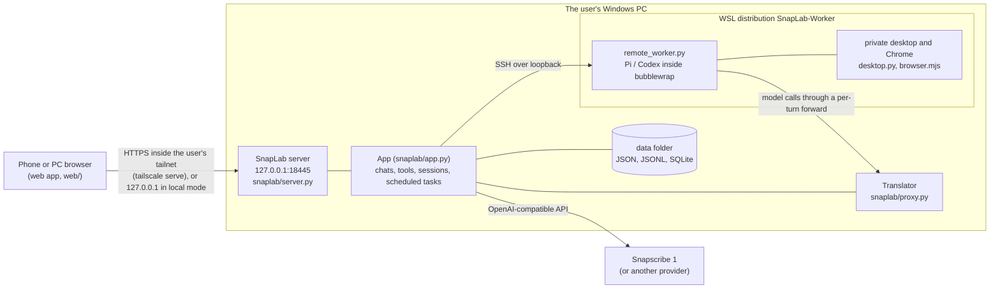
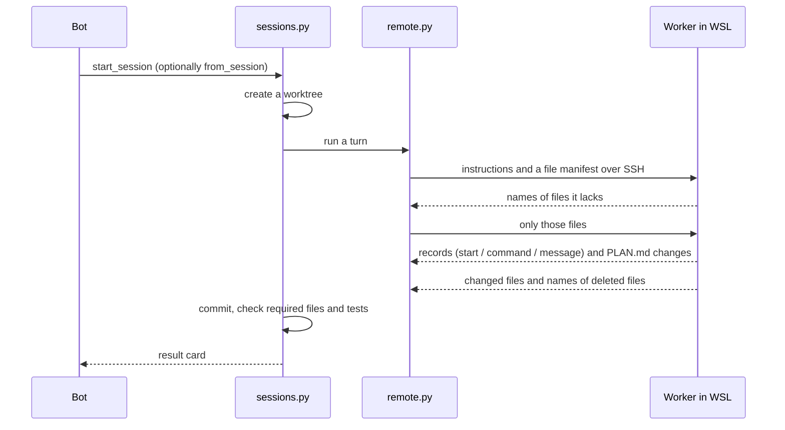

# SnapLab map

How the parts fit together. Keep this file and [CHANGELOG.md](CHANGELOG.md) up to date in the same commit as a
change to the structure. For a single file, see [CODEMAP.md](CODEMAP.md) (one line per file, generated by
`python tools/codemap.py`).

SnapLab is a server that runs on the user's PC. The user talks to AI bots from a phone (an installed web app) or
the PC's browser. Bots chat, search, remember, run scheduled tasks and use connected MCP tools, and they hand long
work to **SnapCode**: Pi or Codex running in an isolated Linux workspace (WSL) on the same PC.

## 1. What runs where

| Place | What it holds |
|---|---|
| App folder (`~/.snaplab/app` by default) | This repository |
| `config.json` in the app folder | Machine-specific settings (ignored by git). Optional |
| Data folder (`~/.snaplab/data` by default) | Everything SnapLab records. See section 4 |
| WSL distribution `SnapLab-Worker` | The SnapCode workspace: Codex, Pi, Chrome and a virtual screen. Set up and updated by `python tools/setup_wsl.py --resume`; see [local-wsl.md](local-wsl.md) |

## 2. Main parts

### Bots and chat
- `chat.py`: who answers and in what order, streaming replies, question cards. In groups, `@Name` answers first and
  every member may choose `[SILENT]`.
- `uploads.py`: photos and files the user sends to a chat: upload checks, what the model receives,
  `read_attachment`, and copies into a SnapCode workspace (`from_chat/`).
- `context.py`: what a bot receives on each call (instructions, memory, room state, history). "Start afresh"
  (`app.start_fresh`, the bot tool `start_fresh`) hides older messages without deleting them.
- `prompts.py`: house rules. Everything about SnapCode is in `snapcode_rules()`.
- `agent.py`: the tool loop shared by chats and bot-only sessions.
- `tools.py`: the bots' tools (`CHAT_TOOLS`) and their executor `Toolbox`. Approval defaults are `DEFAULT_APPROVALS`
  plus the `approvals` setting.
- `dialogue.py`: limits on bot-to-bot conversations and the marks for outside material that was read.
- `models.py`, `llm.py`, `provider_protocol.py`: model registry, Chat Completions client and provider differences.
  The default model is shown as "Snapscribe 1".
- `slots.py`: how many model calls may run at once (file locks).
- `mcp_client.py`, `web_mcp.py`, `plugins.py`, `websearch.py`: external MCP servers as tools, the MCP server that
  gives SnapCode its web and MCP tools, single-file tool plugins, and web search.

### SnapCode (background work)
- `sessions.py`: creating a session, running a turn, result cards, merging. A session works in its own git worktree
  (`<project>/.worktrees/<sid>`, branch `snaplab/<sid>`); several can run in one project at once. `from_session`
  starts from another session's files without its conversation (for reviews and second attempts).
- `harnesses/selection.py`: which agent runs a turn: Codex for desktop work and screen operation, Pi for everything
  else; a failed Pi turn is retried once with Codex.
- `harnesses/remote.py`: sends a turn to the Linux workspace over SSH and brings back records, plan changes and
  files. Only changed files move: SnapLab sends a manifest of SHA-256 digests, the worker asks for what it lacks,
  and returns only changed and deleted files. The worker keeps job folders between turns and copies identical
  files from earlier jobs of the same project.
- `harnesses/remote_worker.py`: the worker side (sent with each turn).
- `harnesses/adapters.py`: turns Pi and Codex records into one format.
- `harnesses/desktop.py`, `browser.mjs`, `capture.*`, `keep.py`: the private desktop, the Chrome the agent drives,
  screenshots, and processes kept until the end of a turn. `desktop.py marks` numbers clickable things so the
  agent clicks `--mark N` instead of guessing coordinates. See [computer-use.md](computer-use.md).
- `harnesses/base.py`, `contract.py`: the harness interface and its check.
- `harnesses/codex.py`, `pi.py`, `bot.py`, `tests.py`: the harnesses (Codex, Pi, bot only, tests only).
- `harnesses/wsl.py`, `wsl_network.py`, `wsl_runtime.py`: starting and sharing the WSL workspace, its network relay
  and its sandbox.
- `proxy.py`: the translator. Codex and Pi call it as their model; it converts Responses API requests to Chat
  Completions and keeps the API key out of the workspace.
- `plan.py`: reads the `.snaplab/PLAN.md` checklist, also while a turn runs.
- `attachments.py`: delivers SnapCode results (images, files) to the chat.
- `gitops.py`, `evidence.py`, `testparse.py`: git operations, file digests and test results.

### Scheduled tasks and progress
- `tasks.py`: daily, weekly and every-N-minutes tasks, and one-time wake-ups (`schedule_wakeup`).
- `get_session(events=N)` and `list_sessions(status="active")` let a bot look at progress when it wants to.

### Memory and records
- `store.py`: all reads and writes of the data folder.
- `archive.py`: the raw archive and full-text search (`recall`, SQLite trigrams; the index is replaceable).
- `memory.py`, `facts.py`, `ledger.py`, `temporal.py`, `summary_schema.py`: notes, facts with sources, approval and
  state records, time handling and room summaries.
- `background.py`: room summaries and the nightly memory tidy (always behind chats).
- `qwen_log.py`: a local log of model calls for troubleshooting.

### Server and screens
- `server.py`: HTTP and server-sent events (standard library only). `auth.py`: device pairing, and the Tailscale
  owner check when SnapLab is published in a tailnet. `access.py`: who may see which project.
- `setup.py`: first-run provider setup (Snapscribe 1, OpenRouter, OpenCode or any OpenAI-compatible API).
- `presets.py`: the provider presets the setup page offers, in one place. config.json ("presets") and the
  SNAPLAB_SNAPSCRIBE_URL / SNAPLAB_SNAPSCRIBE_MODEL environment variables override them.
- `deploy.py`: restarts by an updater: cut-off replies and sessions are resumed after the new version starts.
- `migrate.py`: data migrations between versions.
- `web/app.js`: the whole UI (no framework, no build). `web/i18n/{en,ja,ru}.js` hold the text, `web/app.css` the
  look, `web/sw.js` and `web/update.js` updates and draft protection.
- `usage.py`: API usage views. `dashboard.py`: widgets bots write. `push.py`: Web Push. `avatars.py`, `icons.py`:
  faces and icons. `i18n.py`: language files for the server.

### Protection
- `guard.py`: removes API key values from everything SnapLab stores, shows or sends.
- `privacy.py`: replaces private words (home folder, user name, computer name, tailnet name) before text leaves the PC.
- `credentials.py`: the OS credential store.
- `config.py`, `bus.py`: settings and in-process events.

## 3. One turn

### A bot's turn
1. The user's message reaches `chat.post`. Files were uploaded first (`/api/rooms/<id>/files`) and are attached by id.
2. `context.py` builds the instructions, the state and the history; `uploads.expand` turns file lines into images
   and text.
3. `agent.py` calls the model and the tools of `Toolbox` until the reply is done.
4. The reply streams to the phone and is saved in `messages/<room>.jsonl`.

### A SnapCode turn

## 4. The data folder

| File | Contents |
|---|---|
| `bots.json`, `rooms.json`, `projects.json` | Bots, rooms, projects |
| `archived_bots.json`, `former_bots.json` | Archived bots (can be restored) and deleted bots |
| `messages/<room>.jsonl` | Conversations |
| `rooms/<room>/summary.json` | Room summaries |
| `sessions/<sid>.json`, `.events.jsonl`, `.result.json` | SnapCode state, records and results |
| `projects/<slug>/` | Project folders (git); `.worktrees/<sid>` per session |
| `tasks.json` | Scheduled tasks and wake-ups |
| `usage.json`, `usage/<date>.json` | API usage |
| `dashboard.json`, `settings.json`, `questions.json` | Dashboard, settings, question cards |
| `archive/` | The raw archive and its search index |
| `attachments/<id>/` | Files bots delivered and files the user sent |

## 5. Settings (config.json)

- `models`, `providers`, `routing`: models and which one each kind of call uses ([extending.md](extending.md)).
- `codex.backend`: `wsl` (the SnapCode workspace on this PC), `local` (Codex in the Windows sandbox, no desktop)
  or `ssh` (an advanced option: a Linux machine you prepare yourself).
- `mcp_servers`: external MCP servers; `label` and `about` are what bots are told.
- `approvals`: which bot actions wait for the user's OK on a card.
- `sessions`, `tasks`, `bot_conversations`: 0 means no limit. Limits that end long work are off by default.
- `context`: how much a bot sees per call.

## 6. Development

1. Change the code. Files use LF line endings.
2. Run the tests: `python -m unittest discover -s tests` (no API calls), and the UI checks `node tests/<name>_ui.mjs`.
3. When files are added or removed: mention them here, run `python tools/codemap.py`, and add a line to
   [CHANGELOG.md](CHANGELOG.md). `tests/test_docs_map.py` finds files that are missing from this map.

## 7. Principles

- Give bots and SnapCode as much freedom as possible: no caps on turns, time or counts unless really needed.
- Kept rules: API keys never leave SnapLab; payment, identity checks and CAPTCHAs stop the work; work the user
  stopped is not restarted on its own; instructions inside outside material are not followed.
