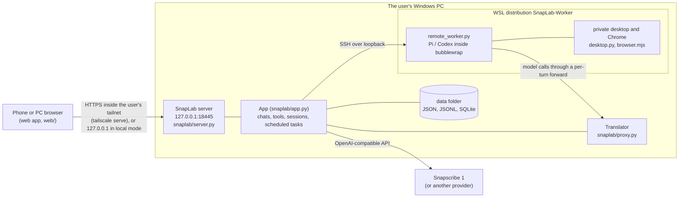
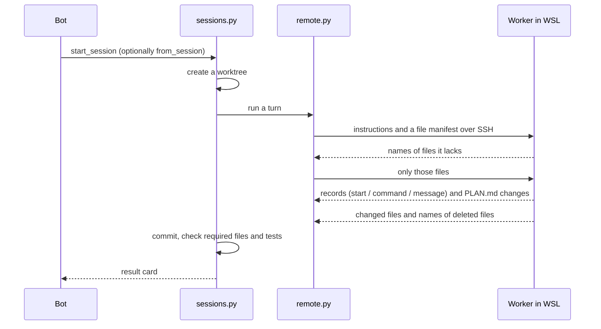

# SnapLab map

How the parts fit together. Keep this file and [CHANGELOG.md](CHANGELOG.md) up to date in the same commit as a
change to the structure. For a single file, see [CODEMAP.md](CODEMAP.md) (one line per file, generated by
`python tools/codemap.py`).

SnapLab is a server that runs on the user's PC. The user talks to AI bots from a phone (an installed web app) or
the PC's browser. Bots chat, search, remember, run scheduled tasks and use connected MCP tools, and they hand long
work to **SnapCode**: Pi or Codex running in an isolated Linux workspace (WSL) on the same PC.

## 1. What runs where

| Place | What it holds |
|---|---|
| App folder (`~/.snaplab/app` by default) | This repository |
| `config.json` in the app folder | Machine-specific settings (ignored by git). Optional |
| Data folder (`~/.snaplab/data` by default) | Everything SnapLab records. See section 4 |
| WSL distribution `SnapLab-Worker` | The SnapCode workspace: Codex, Pi, Chrome and a virtual screen. Set up and updated by `python tools/setup_wsl.py --resume`; see [local-wsl.md](local-wsl.md) |

## 2. Main parts

### Bots and chat
- `chat.py`: who answers and in what order, streaming replies, question cards. In groups, `@Name` answers first and
  every member may choose `[SILENT]`.
- `uploads.py`: photos and files the user sends to a chat: upload checks, what the model receives,
  `read_attachment`, and copies into a SnapCode workspace (`from_chat/`).
- Memory lane 1 (`context.auto_recall`): before each reply the latest message is looked up in the archive, and at
  most 3 trusted, clearly relevant records from earlier (what people said, notes, summaries; never web pages or
  tool output) are put into the latest message with their record ids. No model call; `recall` is lane 2.
  Settings: config.json "recall": {"auto": {"enabled", "max_items", "min_coverage", "min_dense"}}.
- `context.py`: budgets for each call come from the model's window (`budgets`): the messages fit what the provider
  check leaves after the reply and the tool list, notes keep their newest lines (`clip_newest`), and windows of 16K
  or less get a shorter tool list (`tools.compact_schemas`).
- `context.py`: what a bot receives on each call (instructions, memory, room state, history). "Start afresh"
  (`app.start_fresh`, the bot tool `start_fresh`) hides older messages without deleting them.
- `prompts.py`: house rules. Everything about SnapCode is in `snapcode_rules()`.
- `agent.py`: the tool loop shared by chats and bot-only sessions.
- `tools.py`: the bots' tools (`CHAT_TOOLS`) and their executor `Toolbox`. Every bot has every tool (until 2026-11-21
  some were the lead's alone). A card shows only when the `approvals` setting asks for one (`DEFAULT_APPROVALS` is
  `never` for every action).
- `dialogue.py`: bot-to-bot conversations: the user's stop, optional limits in `bot_conversations` (none by
  default), and the marks for outside material that was read.
- `models.py`, `llm.py`, `provider_protocol.py`: model registry, Chat Completions client and provider differences.
  The default model is shown as "Snapscribe 1".
- `slots.py`: how many model calls may run at once (file locks).
- `mcp_client.py`, `web_mcp.py`, `plugins.py`, `websearch.py`: external MCP servers as tools (Streamable HTTP and
  stdio), the MCP server that gives SnapCode its web and MCP tools, single-file tool plugins, and web search.
  Web search tries Tavily (key), Brave (key), DuckDuckGo, then Tavily keyless, and pauses a source that refuses;
  keys are entered in Settings > Web search (`setup.search_key`, credential names `TAVILY_API_KEY` / `BRAVE_API_KEY`).
  `rustxng.py` installs RustXNG on the first start when it is missing (pinned release, SHA-256 checked) and starts it
  on every start; its profile (full by default, standard, clean) is chosen in Settings > Web search.
- `mcp_admin.py`: MCP servers added in Settings (`data/mcp_servers.json`, secrets in the OS credential store);
  each is tested before it is saved, and `app.reload_mcp()` applies changes without a restart.

### SnapCode (background work)
- `sessions.py`: creating a session, running a turn, result cards, merging. A session works in its own git worktree
  (`<project>/.worktrees/<sid>`, branch `snaplab/<sid>`); several can run in one project at once. `from_session`
  starts from another session's files without its conversation (for reviews and second attempts).
- `harnesses/selection.py`: which agent runs a turn: Codex for desktop work and screen operation, Pi for everything
  else; a failed Pi turn is retried once with Codex.
- `harnesses/remote.py`: sends a turn to the Linux workspace over SSH and brings back records, plan changes and
  files. Only changed files move: SnapLab sends a manifest of SHA-256 digests, the worker asks for what it lacks,
  and returns only changed and deleted files. The worker keeps job folders between turns and copies identical
  files from earlier jobs of the same project.
- `harnesses/remote_worker.py`: the worker side (sent with each turn).
- `harnesses/adapters.py`: turns Pi and Codex records into one format.
- `harnesses/desktop.py`, `browser.mjs`, `capture.*`, `keep.py`: the private desktop, the Chrome the agent drives,
  screenshots, and processes kept until the end of a turn. `desktop.py marks` numbers clickable things so the
  agent clicks `--mark N` instead of guessing coordinates. See [computer-use.md](computer-use.md). The live browser
  is a Chrome window on the job's screen by default (`--headless` for one without), and its profile keeps sign-ins
  and tabs between turns.
- `browser_live.py`: the browser panel (`#/browser/<session>`, "Open browser" on a SnapCode session). The user
  watches the session's Chrome live and, after Take over (always between turns), clicks, scrolls, types (IME
  text arrives finished) and navigates. During a turn it is the agent's own browser; between turns SnapLab runs it
  alone in the same sandbox with the same profile (`remote_worker.live`, host mode), so a sign-in made here is there
  for the agent. The DevTools protocol goes through SSH and the job's `.snaplab/live.sock` (`browser.mjs --live`);
  the debugging port never leaves the job. Frames (Page.startScreencast, JPEG, only while someone watches) and the
  state go to the page as server-sent events (`/api/browser/<id>/live`); input is `POST /api/browser/<id>`. While
  the user holds control, `browser.mjs` and `desktop.py` input wait, and a phone viewer gets pages laid out for its
  screen (device-metrics emulation, cleared on hand back). A turn that starts while the panel's own browser runs
  closes it first (Chrome exits cleanly, so cookies are written); the turn's worker waits up to 90 s for the job
  lock. Typed text is never logged or archived.
- `harnesses/base.py`, `contract.py`: the harness interface and its check.
- `harnesses/codex.py`, `pi.py`, `bot.py`, `tests.py`: the harnesses (Codex, Pi, bot only, tests only).
- `harnesses/wsl.py`, `wsl_network.py`, `wsl_runtime.py`: starting and sharing the WSL workspace, its network relay
  and its sandbox.
- `proxy.py`: the translator. Codex and Pi call it as their model; it converts Responses API requests to Chat
  Completions and keeps the API key out of the workspace.
- `plan.py`: reads the `.snaplab/PLAN.md` checklist, also while a turn runs.
- `attachments.py`: delivers SnapCode results (images, files) to the chat.
- `gitops.py`, `evidence.py`, `testparse.py`: git operations, file digests and test results.

### Scheduled tasks and progress
- `tasks.py`: daily, weekly and every-N-minutes tasks (any interval above 0; the scheduler looks every 20 s), and
  one-time wake-ups (`schedule_wakeup`). A run missed while the PC was off is done once when SnapLab is back,
  however late.
- `get_session(events=N)` and `list_sessions(status="active")` let a bot look at progress when it wants to.
- Experiment (2026-11-22, off by default): `decision_watch.py`. When switched on in Settings > Experiments, every 2
  minutes it looks at running SnapCode sessions and bot replies being written. Work without progress for 10 minutes
  is described to a decision model (OpenRouter's `liquid/d1.2-ultra`, key `OPENROUTER_API_KEY`) with one yes/no
  question; at 0.6 or more a bot is woken (the session's bot, or the lead bot for a stuck reply, or the owner's
  phone when the lead itself is stuck). Nothing is stopped. Values are in config `decision_watch`; decisions are
  logged to `data/decision-watch.jsonl`.

### Memory and records
- `store.py`: all reads and writes of the data folder.
- `archive.py`: the raw archive and the search behind `recall` (the index is replaceable with "recall.index").
- `hybrid_index.py`: the default index. Records are cut into ~350-token chunks; two word searches (SQLite FTS5
  trigrams, and CJK character bigrams for 1-2 character Japanese words) and a search by meaning are fused by rank
  (RRF), plus a small bonus for the share of the query's words found. Each hit carries `coverage` and `dense`, which
  memory lane 1 uses. Chunks and vectors are made by a background thread that waits while a bot turn runs; until
  they are ready the plain whole-record trigram search (FtsIndex) answers.
- `embedder.py`: the meaning model (multilingual-e5-small, int8 ONNX, on the CPU), downloaded once from a pinned
  revision and checked by SHA-256. Without numpy/onnxruntime/tokenizers, or without the download, recall searches
  by words only. "recall": {"semantic": false} turns it off.
- `memory.py`, `facts.py`, `ledger.py`, `temporal.py`, `summary_schema.py`: notes, facts with sources, approval and
  state records, time handling and room summaries.
- `background.py`: room summaries and the nightly memory tidy (always behind chats).
- `qwen_log.py`: a local log of model calls for troubleshooting.

### Server and screens
- `server.py`: HTTP and server-sent events (standard library only). `auth.py`: device pairing, and the Tailscale
  owner check when SnapLab is published in a tailnet. `access.py`: every bot may read and manage every project;
  ownership and shares (`looked_after`) only decide which projects a bot's context shows.
- `setup.py`: first-run provider setup (Snapscribe 1, OpenRouter, OpenCode, Google Gemini or any OpenAI-compatible
  API), and Settings > Models: "Use for bots" (`set_default`, routing `chat`) and "Remove" (`remove_model`).
- `cli_admin.py`: Settings > Advanced > AI apps signed in on this PC. Shows whether Claude Code and the Codex CLI
  are installed and signed in (never the account), opens a PowerShell window with the official install or sign-in
  command on Windows (the page shows the command on Linux and macOS; never from a phone), tests one short turn, and
  adds the app as a model. `claude_cli.py` and `codex_cli.py` run a bot's whole turn in that program with its
  built-in tools off; SnapLab's tools reach it through a loopback MCP endpoint (one per turn, random bearer token),
  so approval cards and the archive work as for other bots (`agent.run_loop` hands such a turn to `run_agent`).
  SnapLab never reads or stores these logins. Gemini is added with an API key, because Google does not allow
  other apps to use the Gemini CLI sign-in.
- `presets.py`: the provider presets the setup page offers, in one place. config.json ("presets") and the
  SNAPLAB_SNAPSCRIBE_URL / SNAPLAB_SNAPSCRIBE_MODEL environment variables override them.
- `phone.py`: phone access for a local installation. Installs Tailscale (Windows), waits for sign-in, publishes
  SnapLab with `tailscale serve` inside the user's tailnet, and makes a 15-minute pairing QR code (with the vendored
  MIT `vendor/qrcodegen.py`). `server.py` accepts a request through `tailscale serve` only when phone access is on,
  the Host is this PC's tailnet address, the login is the tailnet owner, and the device is paired; such a phone
  cannot change the phone setup.
- First run: the setup page (key), onboarding (first bot), then a four-card tour (`showTour` in app.js) that ends
  with Set up / Not now for phone access (`renderPhone`, also under Settings).
- `deploy.py`: restarts by an updater: cut-off replies and sessions are resumed after the new version starts.
- `migrate.py`: data migrations between versions.
- `web/app.js`: the whole UI (no framework, no build). `web/i18n/{en,ja,ru}.js` hold the text, `web/app.css` the
  look, `web/sw.js` and `web/update.js` updates and draft protection.
- `usage.py`: API usage views. `dashboard.py`: widgets bots write. `push.py`: Web Push. `avatars.py`, `icons.py`:
  faces and icons. `i18n.py`: language files for the server.

### Protection
- `guard.py`: removes API key values from everything SnapLab stores, shows or sends.
- `privacy.py`: replaces private words (home folder, user name, computer name, tailnet name) before text leaves the PC.
- `credentials.py`: the OS credential store.
- `config.py`, `bus.py`: settings and in-process events.

## 3. One turn

### A bot's turn
1. The user's message reaches `chat.post`. Files were uploaded first (`/api/rooms/<id>/files`) and are attached by id.
2. `context.py` builds the instructions, the state and the history; `uploads.expand` turns file lines into images
   and text.
3. `agent.py` calls the model and the tools of `Toolbox` until the reply is done.
4. The reply streams to the phone and is saved in `messages/<room>.jsonl`.

### A SnapCode turn

## 4. The data folder

| File | Contents |
|---|---|
| `bots.json`, `rooms.json`, `projects.json` | Bots, rooms, projects |
| `archived_bots.json`, `former_bots.json` | Archived bots (can be restored) and deleted bots |
| `messages/<room>.jsonl` | Conversations |
| `rooms/<room>/summary.json` | Room summaries |
| `sessions/<sid>.json`, `.events.jsonl`, `.result.json` | SnapCode state, records and results |
| `projects/<slug>/` | Project folders (git); `.worktrees/<sid>` per session |
| `tasks.json` | Scheduled tasks and wake-ups |
| `usage.json`, `usage/<date>.json` | API usage |
| `dashboard.json`, `settings.json`, `questions.json` | Dashboard, settings, question cards |
| `archive/` | The raw archive and its search index |
| `attachments/<id>/` | Files bots delivered and files the user sent |

## 5. Settings (config.json)

- `models`, `providers`, `routing`: models and which one each kind of call uses ([extending.md](extending.md)).
- `codex.backend`: `wsl` (the SnapCode workspace on this PC), `local` (Codex in the Windows sandbox, no desktop)
  or `ssh` (an advanced option: a Linux machine you prepare yourself).
- `mcp_servers`: external MCP servers; `label` and `about` are what bots are told.
- `approvals`: which bot actions wait for the user's OK on a card (none by default).
- `sessions`, `tasks`, `bot_conversations`, `api.timeout_s`, `chat.max_tokens`, `api.work_max_tokens`,
  `memory_chars`, `user_note_chars`: 0 means no limit, and that is the default (2026-11-21). Waits without a time
  limit end with the Stop button.
- `context`: how much a bot sees per call.

## 6. Development

The Windows installer is `installer/SnapLabSetup.cs` (build with `installer/build.ps1`); see
[installer.md](installer.md) for its steps, options and how it is tested. Linux and macOS use `install.sh`; on Linux
`tools/setup_linux_worker.sh` makes the SnapCode workspace a separate `snaplab` account reached over SSH from the PC
only (codex.backend "ssh" with host 127.0.0.1), see [linux.md](linux.md). On macOS `tools/setup_mac_worker.sh` puts
the same account in a Lima VM, see [mac.md](mac.md).

1. Change the code. Files use LF line endings.
2. Run the tests: `python -m unittest discover -s tests` (no API calls), and the UI checks `node tests/<name>_ui.mjs`.
3. When files are added or removed: mention them here, run `python tools/codemap.py`, and add a line to
   [CHANGELOG.md](CHANGELOG.md). `tests/test_docs_map.py` finds files that are missing from this map.

## 7. Principles

- Freedom first: give bots and SnapCode as much freedom as possible; rules come later, and only when the owner
  decides on them. No caps on turns, time, counts or sizes by default: 0 means no limit, and waits end when the
  work is stopped, not by the clock.
- Do not add prohibitions, caps or timeouts on your own judgment.
- Kept rules: API keys never leave SnapLab; a payment (card entry) stops the work and is reported; SnapCode may
  type the logins and passwords its task gives it.
- Security boundaries, kept until the owner decides otherwise: key redaction (`guard.py`); private-word replacement
  (`privacy.py`) and the instructions not to put personal details into searches or SnapCode and not to save secrets
  in memory; instructions inside outside material are not followed; chat bots never run code; bot-only session file
  tools stay inside the project folder; the dashboard takes data only; `read_page` refuses local, private and
  tailnet addresses and non-http(s) URLs; the WSL workspace's network relay and bubblewrap sandbox; secret
  environment variables and credential files never reach SnapCode, and files with personal details are not sent
  to it; HTML is download-only; device pairing and the tailnet-owner check; git never climbs out of a project; the
  Claude Code and Codex CLI built-in tools stay off; SnapCode's screen and file scope; the worker's memory limits;
  the Codex and Pi feature switches.
